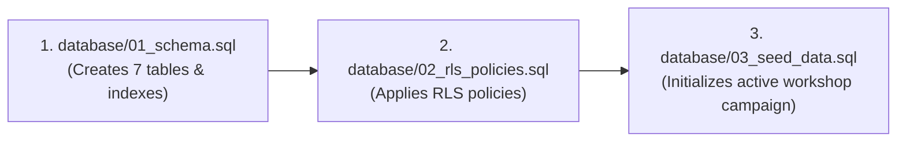

# LaunchLoop AI — Student Acquisition & Growth Platform

> **NxtWave Growth Challenge:** Acquire **500 verified final-year engineering student registrations** for the free online workshop:  
> **"Build Your First AI Project in 60 Minutes"** within **7 days** on a **₹2,000 budget** (Target CAC: ₹4.00/student).

---

## 1. Executive Summary & Core Value Proposition

LaunchLoop AI combines practical AI utility with an organic viral loop to solve student acquisition for technical workshops:
1. **AI Project Magnet:** Instead of an empty form, students receive an instant, customized project blueprint matching their exact programming background and career goals.
2. **Frictionless Registration:** Persists student data with duplicate prevention, pre-fills project parameters, and assigns a unique referral code (`NXTAAR01`).
3. **Viral Referral Loop:** 1-click sharing to WhatsApp and LinkedIn with salted SHA-256 IP click hashing and tiered milestone incentives (Priority Q&A, AI Starter Kit, Resume Review).
4. **Organizer Growth Analytics:** Protected dashboard with real-time KPI tracking, daily velocity charts, channel attribution, and viral funnel diagnostics.
5. **AI Growth Intelligence:** Uses Google Gemini to analyze live aggregated telemetry (with zero PII exposure) to produce grounded, prioritized growth hypotheses.

---

## 2. Technology Stack & Design Principles

- **Frontend:** Pure React 19 + JavaScript (Vite + Tailwind CSS). **Strictly zero TypeScript**.
- **Backend:** Python 3.11 + FastAPI + Pydantic v2 + Uvicorn.
- **Database & Auth:** Supabase PostgreSQL with Row Level Security (RLS) policies.
- **AI Core:** Google Gemini (`gemini-3.8-flash`) via the official `google-genai` Python SDK + 15-item curated fallback catalogue.
- **Testing:** Pytest with AnyIO/AsyncIO. 63 unit and integration tests passing.

---

## 3. Architecture & Monorepo Structure

```text
Nxtwave_project1/
├── database/                    # Versioned, non-destructive SQL migrations
│   ├── 01_schema.sql            # Core 7 relational tables, constraints & indexes
│   ├── 02_rls_policies.sql      # Least-privilege Supabase Row Level Security rules
│   ├── 03_seed_data.sql         # Clean baseline campaign data (Zero fake registrations)
│   ├── 04_demo_simulation.sql   # Optional testing data with valid hex UUIDs
│   └── rollback.sql             # Clean reset script
├── backend/                     # FastAPI backend application (Python 3.11)
│   ├── app/
│   │   ├── ai_providers/        # Google GenAI provider & interface abstractions
│   │   ├── core/                # Config, database connection manager, security
│   │   ├── routers/             # health, magnet, registrations, referrals, analytics
│   │   ├── schemas/             # Pydantic validation schemas
│   │   └── services/            # ai_service, registration, referral, analytics, growth_ai
│   ├── tests/                   # 63 automated unit, integration, and security tests
│   ├── Dockerfile               # Production container build
│   ├── render.yaml              # Render Blueprint deployment definition
│   ├── requirements.txt         # Pinned backend dependencies
│   ├── pytest.ini               # Test configuration
│   └── main.py                  # Server entry point
├── frontend/                    # Pure React + JavaScript (Vite + Tailwind CSS)
│   ├── src/
│   │   ├── api/                 # magnet.js, registration.js, analytics.js
│   │   ├── components/
│   │   │   ├── dashboard/       # Organizer dashboard, KPI cards, charts, AI intelligence
│   │   │   ├── magnet/          # AI Magnet interactive form & project cards
│   │   │   ├── referral/        # StudentReferralHub, Leaderboard
│   │   │   ├── registration/    # RegistrationForm, SuccessModal
│   │   │   └── workshop/        # Curriculum breakdown, scope comparison, FAQ
│   │   ├── hooks/               # useReferralTracker (auto-detects ?ref=CODE)
│   │   ├── App.jsx              # Main tabbed single-page application
│   │   └── main.jsx
│   ├── vercel.json              # Vercel SPA deployment configuration
│   └── package.json
└── docs/                        # Deliverables for NxtWave Assessment Submission
    ├── growth_campaign_plan.md  # 7-day 500-student growth strategy & ₹2,000 budget
    ├── ai_learning_notes.md     # 3 concrete prompt engineering experiments
    ├── demo_script.md           # Timed natural 3-minute video presentation script
    ├── smoke_test_checklist.md  # 10-point end-to-end verification protocol
    └── submission_checklist.md  # Formal assessment deliverables tracker
```

---

## 4. Supabase Database Setup Guide

Run the versioned scripts in your [Supabase SQL Editor](https://supabase.com/dashboard/project/alspsjdgtacgmacrzmfh/sql/new) in this exact order:



1. **Step 1:** Run [database/01_schema.sql](database/01_schema.sql) to create `campaigns`, `students`, `registrations`, `referral_links`, `referral_events`, `campaign_variants`, and `ai_generation_logs`.
2. **Step 2:** Run [database/02_rls_policies.sql](database/02_rls_policies.sql) to enable Row Level Security and least-privilege policies.
3. **Step 3:** Run [database/03_seed_data.sql](database/03_seed_data.sql) to initialize the target workshop campaign (`ai-in-60-mins`) with clean 0-metrics.

*(Note: [database/04_demo_simulation_data.sql](database/04_demo_simulation_data.sql) is optional for simulated cohort testing).*

---

## 5. Local Development Quickstart

### Prerequisites
- Python 3.11+
- Node.js 18+ and npm

### 1. Backend Setup
```bash
# In the repository root:
python -m pip install -r backend/requirements.txt

# Start backend server on port 8000:
python -m uvicorn main:app --host 127.0.0.1 --port 8000 --app-dir backend
```
- API Base: `http://127.0.0.1:8000`
- Interactive API Docs: `http://127.0.0.1:8000/docs`
- Health Diagnostics: `http://127.0.0.1:8000/api/v1/health`

### 2. Frontend Setup
```bash
# In another terminal:
cd frontend
npm install
npm run dev
```
- Web Application: `http://localhost:5173`

---

## 6. Running Automated Tests

Run the full pytest suite from the project root:
```bash
python -m pytest backend/tests -v
```
**Results:** **63 of 63 tests pass** covering:
- Dual-mode authentication & admin passkey security
- KPI formulas and zero-denominator division safety
- Exclusion of seed data from authentic analytics
- PII sanitization in AI Growth Intelligence prompts
- Structured JSON schema validation and deterministic fallbacks

---

## 7. Deployment Instructions

### Frontend Deployment (Vercel)
1. Import the repository into [Vercel](https://vercel.com).
2. Set Root Directory to `frontend`.
3. Configure Environment Variables:
   - `VITE_API_BASE_URL`: `https://your-backend-api.onrender.com/api/v1`
4. Deploy. Vercel utilizes [frontend/vercel.json](frontend/vercel.json) to handle client routing and security headers.

### Backend Deployment (Render / Docker)
1. Create a **Web Service** on [Render](https://render.com) pointing to this repository.
2. Select runtime **Python** (or use [backend/Dockerfile](backend/Dockerfile)).
3. Build Command: `pip install -r backend/requirements.txt`
4. Start Command: `python -m uvicorn main:app --host 0.0.0.0 --port $PORT --app-dir backend`
5. Configure Environment Variables (Server-side secrets only):
   ```bash
   ENVIRONMENT=production
   ALLOWED_ORIGINS=https://your-frontend.vercel.app
   SUPABASE_URL=https://<project-ref>.supabase.co
   SUPABASE_SERVICE_ROLE_KEY=sb_secret_...
   GEMINI_API_KEY=your-gemini-key
   GEMINI_MODEL=gemini-3.8-flash
   ```

---

## 8. Truthful Limitations & Operational Notes

1. **Supabase Schema Status:** The backend connects to Supabase PostgREST. The tables must be created by executing `database/01_schema.sql` and `database/03_seed_data.sql` in the Supabase SQL Editor. Until applied, `GET /api/v1/health` reports `"schema_pending"`.
2. **Budget Allocation vs. Actual Ad Spend:** The platform calculates budget allocation per registration ceiling (`₹2,000 / real_registrations`). It does not integrate third-party ad networks (e.g. Meta Ads API), so numbers represent allocated budget ceilings rather than live bank spend.
3. **AI Fallback Resilience:** When `GEMINI_API_KEY` is not present, the system transparently serves its verified 15-item curated fallback catalogue and rule-based heuristic growth diagnostic. It never fabricates live AI generation or pretends static text is dynamic.

---

## 9. Deliverables for NxtWave Submission

- **Growth Campaign Plan:** [docs/growth_campaign_plan.md](docs/growth_campaign_plan.md)
- **AI Engineering Notes:** [docs/ai_learning_notes.md](docs/ai_learning_notes.md)
- **3-Minute Video Script:** [docs/demo_script.md](docs/demo_script.md)
- **Integration Smoke Tests:** [docs/smoke_test_checklist.md](docs/smoke_test_checklist.md)
- **Submission Deliverables Checklist:** [docs/submission_checklist.md](docs/submission_checklist.md)
